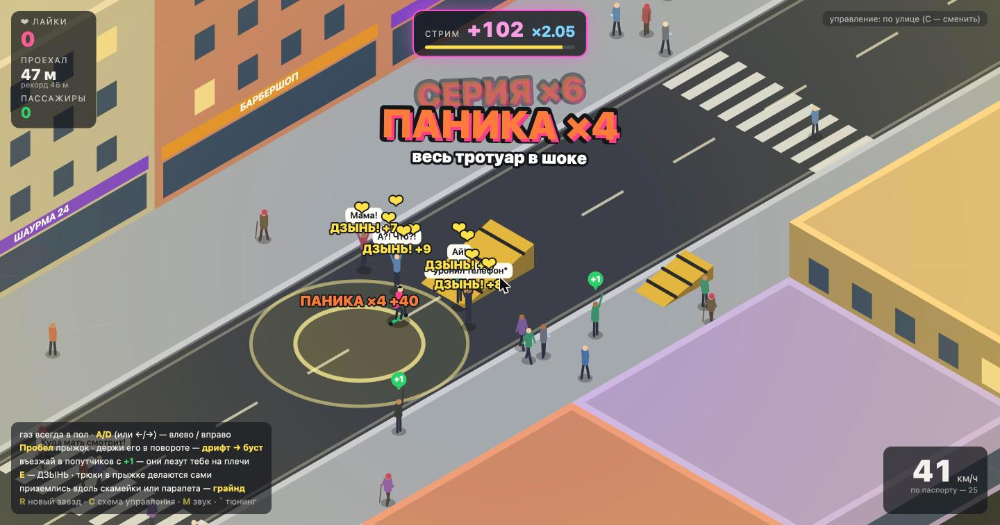

# ДЗЫНЬ (Dzyn)

A satirical arcade game about an e-scooter rider on a city sidewalk. You earn likes for near misses and for scaring people with the bell, and you stack hitchhikers on your shoulders into a swaying tower.

[](https://iansilent.github.io/dzyn/)

**[▶ Play in the browser](https://iansilent.github.io/dzyn/)** · keyboard · UI in Russian

## The idea being tested

Does riding feel good on its own, before any goals are added?

- The scooter is always at full throttle and has no brake. You only choose a side of the street.
- **Near misses** and the **bell** pay likes. Doing it in a row builds a streak with bigger words, a rising chime and a short slow motion on a really close call.
- **Hitchhikers** wave with a green «+1». Ride into one and they climb onto your shoulders, then the next one onto theirs, up to 12. Each passenger adds 25% to every payout. The tower sways, and weaving in rhythm with it throws the top people off.
- Hitting a pedestrian throws the whole tower and drops the streak.

The world is one endless straight street.

## Controls

| Key | Action |
|---|---|
| A / D or ← / → | Steer toward the left or right side of the street |
| Space | Hop; a trick happens by itself. Hold it through the landing while steering to drift, release for a boost |
| E / F | The bell |
| Land along a bench or ledge | Grind |
| R | New run |
| C | Switch the control scheme |
| M | Sound on/off |
| ` | Tuning panel: every movement number as a slider |

## Run locally

Plain HTML, CSS and JavaScript with an isometric canvas renderer. No build step and no dependencies. Open `index.html`.

## Checks

```bash
node tools/check.js
```
